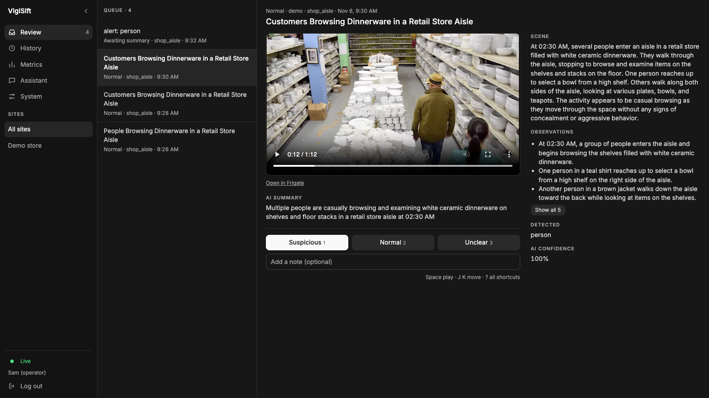
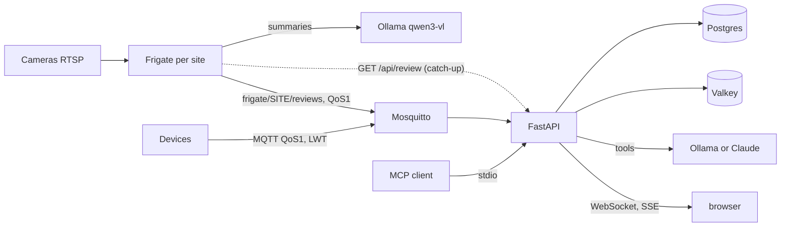

# VigiSift

**AI sifts the alerts, people decide.** A self-hosted console for CCTV operators who watch many
sites, built on [Frigate](https://github.com/blakeblackshear/frigate).

**[Try the live demo](https://vigisift-demo.vercel.app)**: the real console on 4 recorded alerts,
nothing to install. Judge alerts with `1` `2` `3`, move with `J` `K`, play clips with `Space`.



## Where it stands

Measured through the real path (fake camera → Frigate → local vision model → VigiSift) on an
M4 Pro with 24 GB, with `qwen3-vl:8b-instruct` and no paid service:

| | Result |
|---|---|
| Staged theft clips the AI flags | **13/30 (43%)** |
| Normal clips falsely flagged | **1/30** |
| Clips with an AI summary | 59/60 (one clip raised no alert), none timed out |
| Summary delay after an alert closes | ~100 seconds (median) |
| Throughput per vision-model machine | ~50 alerts per hour, across all its cameras |
| Automated tests | 242, against real Postgres, Valkey and Mosquitto |

Read these numbers with care. The clips are staged, with actors, one camera angle and clear
actions, and they were reused across runs, so these numbers compare configurations and don't predict a
real store, where results will be lower. The AI flag is a priority hint, not a filter: every alert
with a person still reaches the operator. The full record, including runs that failed and fixes
that didn't help, is in [docs/03-eval.md](docs/03-eval.md).

## How it works

VigiSift is an alert console, plus a small device backend over MQTT. Each site runs
[Frigate](https://github.com/blakeblackshear/frigate) (MIT), which
detects people, records, and asks a local vision model to summarise each alert with a
threat level. VigiSift collects those alerts from every site into one place, exactly once,
even when messages arrive out of order, twice, or not at all; operators sign in and judge
each alert; admins write what counts as suspicious per camera (a bakery stock room is not a
watch shop) and VigiSift keeps every Frigate in sync with those rules; and an eval harness
measures the whole pipeline on labelled video. Devices send telemetry and
take commands with acknowledgement; an agent answers questions and proposes actions that a
human confirms. Runs fully local with no monthly service fees (Ollama); the Claude API is an
option.



## What it does

| Area | Flow |
|---|---|
| Operator console | sign-in, a review queue (AI-suspicious first), clips playing in the page, Suspicious / Normal / Unclear verdicts, live updates across operators, AI-vs-operator precision, recall and false alarms per hour |
| Camera rules | per-camera normal / suspicious / critical activity, from presets; pushed live to Frigate, re-pushed after outages or drift |
| Rule check | Frigate's vision model describes each alert well but rates nearly everything as normal; VigiSift asks the same local model a text-only question, "which listed indicator does this description match?", and raises the alert to that level. The model only picks from the camera's own indicators, so the level comes from the rules, not from the model |
| Eval | labelled clips replayed through a fake camera into real Frigate, scored on recall, precision and false alarms per hour (`scripts/eval_alerts.py`), with one row per layer so a fault can be traced to detection, the vision model or the rules. The first held-out run scored 0/20 because the eval video's cuts made Frigate skip detection; the eval itself found that. See [docs/03-eval.md](docs/03-eval.md) |
| Camera alerts | Frigate review `new` → `update` → `end` → `genai` summary, merged into one row per (site, review); any arrival order or duplicate gives the same row |
| Catch-up | every 5 minutes each site's Frigate API is read back with a 15-minute overlap, so alerts missed while VigiSift or the network was down still arrive |
| Sites | one MQTT user per site, allowed only under `frigate/<site>/#`; a compromised site cannot post another site's alerts |
| Devices | telemetry up, QoS 1 commands down with ack and timeout, presence via Last Will and heartbeat |
| Scale-out | MQTT shared subscriptions split work; Valkey pub/sub fans WebSocket events to every instance |
| LLM | provider-neutral `ChatModel`; local Ollama or Claude; retry for 429/5xx/529, cost ledger, daily budget |
| Agent | streaming tool loop, validated tool inputs, commands need human confirmation |
| MCP | the same toolbox (devices, recent camera alerts, commands) over stdio for Claude Code or Claude Desktop |

## Run

The [live demo](https://vigisift-demo.vercel.app) needs no server: [demo/](demo/README.md) explains
how it is recorded and built. To run the whole system:

```bash
make install
make up        # postgres, mosquitto, valkey
make seed
make run       # http://127.0.0.1:8000
make check     # ruff, mypy, pytest
```

Everything in containers, including the API and one Frigate site with a fake camera
(downloads: Frigate image ~1.5 GB, `qwen3-vl:8b-instruct` ~6.2 GB):

```bash
scripts/fetch_samples.sh                                         # store-aisle video, sha256-checked
ollama serve &
ollama pull qwen3-vl:8b-instruct
make demo                                                        # http://127.0.0.1:8000
```

`make demo` seeds an `admin` operator with a random password printed once; change it or add
operators with `uv run python scripts/create_operator.py <username> "<name>" [--admin]`.
Frigate's UI is at http://127.0.0.1:8971; its first-run admin password is in
`docker compose logs frigate`. The fake camera loops a store aisle with a 60-second quiet
gap, so a review opens, ends, and gets a summary roughly every two minutes.

Frigate tells the vision model the local time of each alert, and the prompt is warier at night.
`make` passes your machine's time zone to Frigate; when running `docker compose` directly, set it
yourself, for example `TZ=Asia/Ho_Chi_Minh docker compose up -d`. Without it Frigate uses UTC.

Person detector on a Mac (optional). Frigate's default CPU detector is the heaviest part of
the stack. On 12 eval clips, YOLOv9-t on the Neural Engine found people exactly as well and cut
CPU from ~99% of one core (peaks of 224%) to ~43%, Frigate and detector together. On Apple Silicon, detection can run on the Neural Engine outside Docker with
[frigate-nvr/apple-silicon-detector](https://github.com/frigate-nvr/apple-silicon-detector)
(MIT) and YOLOv9-t:

1. Clone it next to this repo and install it in a Python 3.11 venv
   (`uv venv --python 3.11 venv`, then `VIRTUAL_ENV=$PWD/venv uv pip install -r requirements.txt`).
2. Export `yolov9-t-320.onnx` with the Docker build in Frigate's docs (Apple Silicon detector,
   step 2), dropping `onnx-simplifier` and `--simplify`, which do not build on arm64. Put the
   file in `deploy/frigate/config/model_cache/`. Checked with ONNX Runtime on CoreML: 1.4 ms
   per frame, a person found at 0.93 on an eval frame.
3. `make detector`, then switch the `detectors` and `model` blocks as the comments in
   `deploy/frigate/config.template.yml` show, and start Frigate.

The detector's socket has no authentication; `make detector` binds it to 127.0.0.1 only.

Add a real site: `uv run python scripts/register_site.py <id> "<name>" --ui-url ... --api-url ...`
prints the Frigate MQTT settings and the Mosquitto ACL block to add. For a site reached over
the network, give VigiSift a Frigate account (admin, because pushing camera rules uses
Frigate's config API): `FRIGATE_CREDENTIALS='{"<id>": {"user": "vigisift", "password": "..."}}'`.
That account can change the whole Frigate config, so keep the link between VigiSift and each
Frigate on a private network or VPN, never the open internet.

`make demo` copies `deploy/frigate/config.template.yml` to `deploy/frigate/config/config.yml`
once. That copy is not in git: Frigate rewrites it whenever VigiSift pushes camera rules.

Data is not kept forever. Once a day VigiSift deletes alerts nobody judged, LLM call records,
telemetry and finished commands older than `RETENTION_DAYS` (90), and judged alerts with their
verdicts after `REVIEWED_RETENTION_DAYS` (365), since those are the eval labels. Frigate drops
the clips themselves sooner (7 days for alerts in the template).

Running it for real, behind a TLS reverse proxy:

| Setting | Why |
|---|---|
| `SESSION_COOKIE_SECURE=true` (the default outside compose) | the session cookie is then `__Host-`, HTTPS-only |
| `PUBLIC_ORIGIN=https://vigisift.example.com` | writes and the WebSocket must come from the console itself; proxies often rewrite `Host` |
| `FORWARDED_ALLOW_IPS=<proxy address>` | uvicorn then takes the client IP from the proxy for login throttling; `*` only when nothing but the proxy can reach the api |
| `MQTT_PORT=8883`, `MQTT_TLS=true`, `MQTT_CA_FILE` | sites reach the centre's broker over the internet |
| each site's Frigate: `mqtt.port: 8883`, `mqtt.tls_ca_certs`; `tls.enabled: true` | the template shows both; VigiSift trusts a private CA with `FRIGATE_CA_FILE` |

Try it all on the dev stack with a private CA:

```bash
make certs
docker compose restart mosquitto
SESSION_COOKIE_SECURE=true PUBLIC_ORIGIN=https://localhost:8443 FORWARDED_ALLOW_IPS='*' \
  MQTT_PORT=8883 MQTT_TLS=true MQTT_CA_FILE=/certs/ca.crt \
  docker compose --profile tls up -d --build
```

The console is then at https://localhost:8443 (trust `deploy/certs/ca.crt` in the browser, or
accept the warning), and the api talks to Mosquitto on 8883. For a real centre, replace the files
in `deploy/certs/` with certificates from your own or a public CA (Caddy can also fetch a public
one itself: see `deploy/caddy/Caddyfile`), and stop publishing port 1883 beyond localhost.

Simulate devices (password `devpass`):

```bash
uv run python scripts/simulate_device.py lamp-1
```

Kill a simulator with `kill -9` to watch its Last Will mark it offline.

The assistant on a local model, no API cost (the same `qwen3-vl:8b-instruct` Frigate uses):

```bash
ASSISTANT_ENABLED=true make run
```

Or on Claude, with `ANTHROPIC_API_KEY` set:

```bash
ASSISTANT_ENABLED=true ASSISTANT_PROVIDER=anthropic make run
```

`make mcp` serves the same tools over stdio for an MCP client.

The passwords in `compose.yml`, `deploy/mediamtx/mediamtx.yml` and `deploy/mosquitto/passwd` are
well-known development defaults, and those services listen on 127.0.0.1 only. Replace them before
running anywhere else.

## Responsible use

Video surveillance affects people who never agreed to be part of a test, so these rules are part of
the design:

- **AI suggests, a person decides.** A flag is a reason to watch a clip, not a conclusion about
  anyone. VigiSift takes no action on a person.
- **Visible actions only.** The prompts tell the model to describe what can be seen and never to infer
  intent from appearance, clothing, age, gender or ethnicity. Face recognition stays off.
- **Use video you may use.** Follow local privacy and workplace law. Test with public or self-recorded
  video, and don't use workplace footage without written consent. No footage is committed here.

## Design decisions

- **Merge, don't order.** Every merge of a Frigate review is commutative and idempotent
  (severity only escalates, labels union, exact times beat the widened times Frigate sends
  with a summary), so shared subscriptions and catch-up can deliver in any order. A test
  replays a real Frigate review lifecycle in all 120 orders.
- **MQTT is fast, the API is sure.** MQTT carries alerts in real time; a reconcile loop
  reads each site's Frigate API back through the same merge, so missed messages are
  recovered and re-reads change nothing.
- **Look, then judge.** The VLM is asked to describe; judging against the camera's rules is a
  separate, text-only step in VigiSift, constrained to the rule's own indicators by a JSON
  schema enum. Measured on the eval, this is what turned "the summary says the item went into
  a bag" into an alert (docs/03-eval.md).
- **Reuse before writing.** Detection, recording and frame selection for the VLM are
  Frigate's job; see [docs/02-open-source.md](docs/02-open-source.md) for what is reused
  and why.
- **QoS 1 plus idempotency, not QoS 2.** Commands carry an id so devices drop duplicates; an
  ack topic tells delivery apart from execution.
- **Valkey for speed, Postgres for truth.** Presence, cooldowns and budgets live in Valkey and
  can be lost; commands, events and LLM costs live in Postgres.
- **Model output is untrusted.** Tool arguments the model produces are validated before
  anything runs, and tool results go back to it as data, never as instructions.
- **Local first, provider-neutral.** The agent loop only knows a `ChatModel` protocol; Ollama
  and Claude are adapters. Local inference costs nothing per token.
- **Agents propose, humans decide.** `send_command` only creates a one-time confirmation;
  the same rule applies over MCP.
- **Business logic stays out of the adapters.** `features/` reach MQTT, Valkey and the LLM
  only through `ports/`, so tests swap in fakes from `tests/fakes/` and still run against
  real Postgres, Valkey and Mosquitto.

## Not done yet

- **About 50 summaries per hour per VLM machine, shared by all its cameras.** Frigate calls the VLM
  with a hard 120-second timeout and Ollama runs one review at a time. On an M4 Pro (24 GB) with
  `qwen3-vl:8b-instruct` and 8 frames, each review takes ~65 seconds and kept up with one alert every
  ~86 seconds for an hour (0 timeouts). At ~74 alerts per hour from two cameras, about half the alerts
  got no summary. Busier sites need a faster VLM machine, or Frigate zones so only people at the
  products raise alerts: draw a zone in Frigate's UI (Settings, Masks / Zones) and list it in the
  camera's `review.alerts.required_zones` (commented example on `shop_aisle` in the template). Six
  frames instead of eight saved 22% of the time but caught fewer thefts (run 17), so eight stay.
- **Theft recall is moderate, and untested on real footage.** Checking the same frames by eye, about
  half the thefts are clearly visible, so a stronger model could still do better; still images also
  hide direction, and the model sometimes says an item came out of the bag. Rewording the rules has
  stopped helping (run 14 in the eval). The next measurement is real video recorded with consent.
- No single sign-on yet: operators have local accounts (argon2id, server-side sessions).

Plan: [docs/00-roadmap.md](docs/00-roadmap.md).

## Layout

Dependencies point inward only; `tests/test_architecture.py` fails the build otherwise.

```text
src/vigisift/
├─ domain/          pure rules: device states, alert types, operators and verdicts, camera rules
│                   and their prompt, eval scoring, LLM pricing
├─ ports/           Protocols the features need: mqtt, cache, llm, frigate
├─ features/        one slice per capability: HTTP routes, MQTT handlers, SQL, use cases
│  ├─ alerts/       Frigate review payloads, order-independent merge, reconcile loop, /alerts
│  ├─ auth/         operator sign-in, sessions, throttling, same-origin checks
│  ├─ review/       review queue, verdicts, AI-vs-operator metrics, label export
│  ├─ rules/        per-camera rules, push to Frigate, drift detection, rule check
│  ├─ devices/      commands (QoS 1, ack, timeout), presence, repository
│  ├─ telemetry/    ingest, WebSocket hub
│  ├─ assistant/    agent loop, toolbox, confirmations
│  └─ costs/        LLM cost ledger
├─ infra/           adapters behind the ports: Postgres, paho, Valkey, Frigate HTTP API, Ollama, Claude
├─ runtime.py       typed container of ports handed to routes and handlers
├─ bootstrap.py     composition root shared by the API and the MCP server
├─ app.py           FastAPI factory and lifespan
└─ mcp_server.py    MCP adapter over the same toolbox
tests/              mirrors src/: domain/, features/, infra/, plus fakes/ for every port
deploy/             Mosquitto (per-site ACL), Frigate config template, MediaMTX fake cameras
evals/              labelled clip manifest for the eval (videos are downloaded, not committed)
samples/            videos for the fake cameras (not committed; scripts/fetch_samples.sh, eval_alerts.py)
```

## Credits

- [Frigate](https://github.com/blakeblackshear/frigate) (MIT) does the camera work: detection, recording
  and frame selection.
- [Shoplifting Dataset (2022)](https://doi.org/10.17632/r3yjf35hzr), MNNIT, Mendeley Data (CC BY 4.0), for the eval.
- [store-aisle-detection.mp4](https://github.com/intel-iot-devkit/sample-videos) from intel-iot-devkit
  (CC BY 4.0), for the demo camera and the screenshot above.
- [Inter](https://rsms.me/inter/) (SIL Open Font License) is bundled for the console.

## License

[MIT](LICENSE). Third-party pieces keep their own licenses, listed under Credits.
